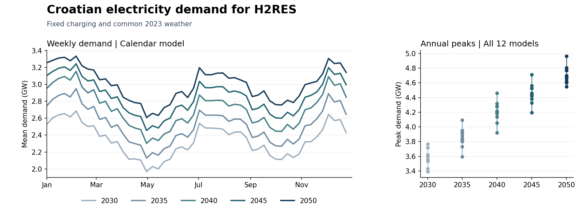

# Croatian electricity demand forecasting and capacity planning

This project compares 12 models of Croatian hourly electricity demand and uses their forecast shapes to build capacity-planning inputs for H2RES. Within each planning year, all models share the same annual electricity and the same road charging, heating and cooling assumptions. The comparison isolates differences in the remaining hourly demand.

## H2RES demand inputs

[Download the hourly profiles](results/planning/h2res/) · [H2RES import and reproduction guide](docs/h2res-demand.md) · [Planning methodology and sources](docs/planning.md)

The package covers **2030, 2035, 2040, 2045 and 2050**. Each year contains 12 profiles on a common 8,760-hour chronology. In 2050, the profiles each total **26.317 TWh**, while their annual peaks span **4.548–4.963 GW**.

## Forecast benchmark

Twelve forecasting workflows generate full-year hourly demand using the Croatian calendar and ERA5 historical weather. The study uses **2019–2022** for model development and **2023–2025** for retrospective comparison of the fixed configurations. **2026** is reserved for the final evaluation.

[Run the benchmark](docs/reproduction.md) · [Read the methodology](docs/methodology.md) · [Results by year](docs/retrospective.md) · [Download archived forecasts](results/profiles/)

### Models and results

The comparison includes a historical calendar baseline, statistical models, tree-based models and neural networks fitted to Croatian data. Chronos-2 and TimesFM-3 use externally pretrained weights.

For 2023–2025, **TimesFM-3** had the lowest mean raw hourly MAE (93.36 MW). **TCN** led on raw MAE among workflows without external pretraining (103.07 MW). **LightGBM** had the lowest mean shape MAE (86.95 MW). See the [checkpoint limitations](docs/methodology.md#pretrained-checkpoints).

Mean absolute error (MAE) averages the size of the hourly errors in MW. Raw MAE scores the forecast as generated. Shape MAE first matches the forecast's annual energy to the observed total, then measures how closely the hourly profiles align. Period averages give each year equal weight.

Model names link to their Python implementations. Use the ID with `src/train.py --model`.

| Model code | `--model` ID | Raw hourly MAE (MW) | Equal-energy shape MAE (MW) |
|---|---|---:|---:|
| [TimesFM-3](src/models/timesfm3.py) | `timesfm3` | **93.36** | 92.68 |
| [TCN](src/models/tcn.py) | `tcn_median` | 103.07 | 94.08 |
| [GAM](src/models/gam.py) | `gam_thermal` | 107.38 | 105.36 |
| [LightGBM](src/models/lightgbm.py) | `lightgbm_thermal` | 107.69 | **86.95** |
| [Random Forest](src/models/random_forest.py) | `random_forest` | 109.82 | 90.97 |
| [MLP](src/models/mlp.py) | `ffn` | 111.13 | 91.06 |
| [N-HiTS](src/models/nhits.py) | `nhits` | 116.95 | 106.35 |
| [LSTM](src/models/lstm.py) | `lstm` | 119.06 | 101.37 |
| [TFT](src/models/tft.py) | `tft` | 132.55 | 104.36 |
| [Calendar baseline](src/models/calendar_baseline.py) | `calendar_recent` | 140.48 | 135.68 |
| [SARIMAX](src/models/sarimax.py) | `sarimax` | 160.18 | 151.37 |
| [Chronos-2](src/models/chronos2.py) | `chronos2` | 274.91 | 277.29 |

[Per-year scores and observed-vs-forecast curves](docs/retrospective.md) · [Development results for 2019–2022](docs/results.md)

## Repository map

| Step | Where to look | What it does |
|---|---|---|
| Prepare inputs | [`src/training_inputs.py`](src/training_inputs.py) · [data sources](data/README.md) | Combines historical load, local calendar and ERA5. Writes a training file and a separate weather/calendar file per year. |
| Generate forecasts | [`src/train.py`](src/train.py) · [model files](src/models/) | Loads the two input files, runs the selected model and writes its hourly MW forecast. |
| Check results | [Scoring audit](src/audit.py) · [Forecast reproduction](results/reproduction-by-year.csv) · [Configuration selection](docs/calibration.md) | Recalculates archived scores and documents how the forecasts and selections were verified. |
| Find settings | [Recorded model settings](configs/model-settings.json) · [evaluation protocol](configs/protocol.json) · [pretrained checkpoints](configs/checkpoints.json) | Model parameters are defined in the Python implementations. The settings JSON records them for reference. The runner reads the protocol and checkpoint manifest. |

## Reproduce the scores

With Python 3.12 or later, run `python src/audit.py --period all` to recompute the published scores from the archived forecasts and source observations. See the [reproduction guide](docs/reproduction.md) to prepare inputs, rerun the models or rebuild figures.

The original project code and its documentation are [MIT-licensed](LICENSE). See the [data and checkpoint terms](data/README.md) for third-party materials and restrictions on TimesFM-3 outputs.
