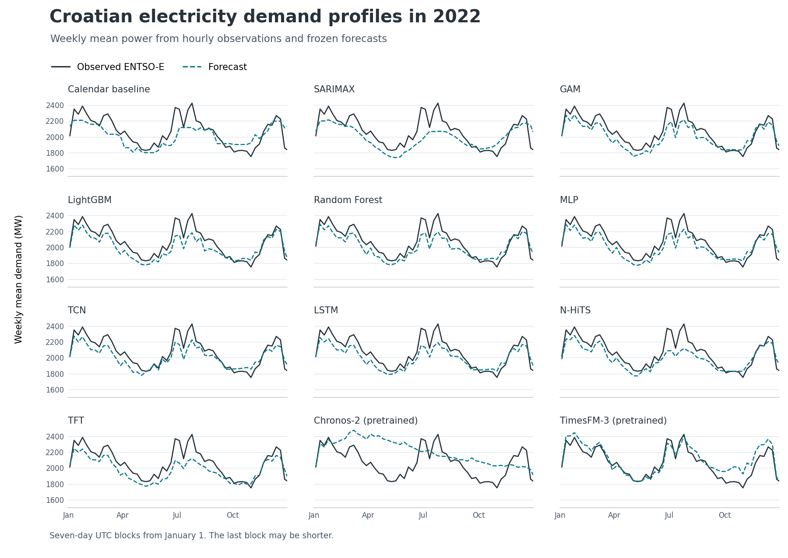

# Croatian hourly electricity demand forecasting

How well do different forecasting workflows reproduce a full year of hourly Croatian electricity demand when evaluated against the same hours and given the same calendar and weather information?

This development benchmark compares **12 frozen workflows** on **2019–2022**. The forecasts are retrospective and conditional on observed ERA5 weather. Measured target-year demand enters only during evaluation. The held-out year 2026 is reserved for final evaluation.

## Development results

| Workflow | Hourly MAE (MW) | Equal-energy shape MAE (MW) |
|---|---:|---:|
| MLP | **87.11** | 74.33 |
| LightGBM | 88.94 | **72.87** |
| Random Forest | 89.11 | 75.11 |
| TCN | 95.66 | 84.65 |
| LSTM | 97.40 | 83.31 |
| GAM | 102.19 | 88.49 |
| N-HiTS | 102.28 | 93.93 |
| TFT | 103.47 | 86.94 |
| TimesFM-3 (pretrained) | 110.88 | 89.12 |
| Calendar baseline | 115.25 | 104.71 |
| SARIMAX | 132.12 | 120.69 |
| Chronos-2 (pretrained) | 246.24 | 205.13 |

The table gives each year equal weight. MLP has the lowest mean raw MAE and LightGBM has the lowest mean shape MAE. These are development scores from years used for configuration selection.

[All metrics by year](results/by-year.csv) · [Four-year means](results/summary.csv) · [Seed sensitivity](results/seed-sensitivity.csv) · [Methodology](docs/methodology.md)



Weekly profile comparisons for [2019](results/figures/profiles-2019.png), [2020](results/figures/profiles-2020.png), [2021](results/figures/profiles-2021.png) and [2022](results/figures/profiles-2022.png) use a common power axis within each year. Metrics use the original hourly values.

## Reproduce the comparison

From the repository root, run with Python 3.12 or later:

```sh
python src/audit.py
```

The command downloads four [SHA-256-pinned ENTSO-E archives](data/README.md) on first use (about 140 MiB). It needs no API key or Python packages. It rebuilds the TCN median from three seeds, checks the UTC grids and compares **48 hourly profiles, 384 per-year metric values and 96 four-year means** against the versioned results. The repository contains the frozen forecasts and scoring code. The audit verifies scoring from saved forecasts. Model refitting requires the forecasting environment and input datasets.

See [model settings](configs/model-settings.json), the [forecast protocol](configs/protocol.json) and [forecast provenance](results/provenance.json).
