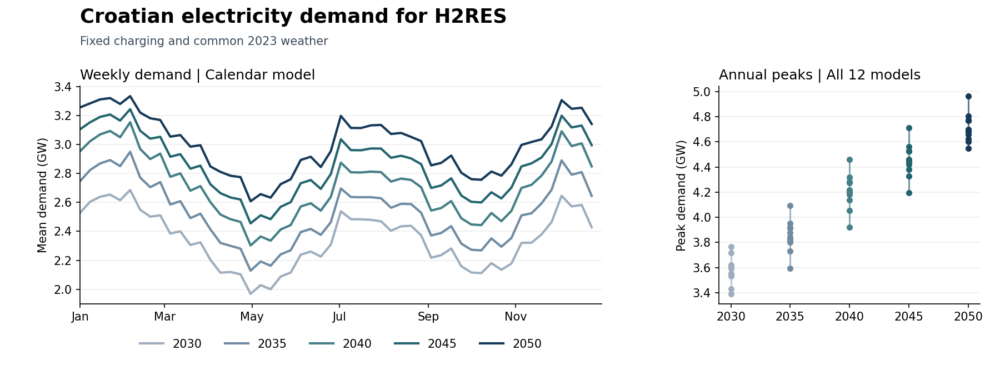
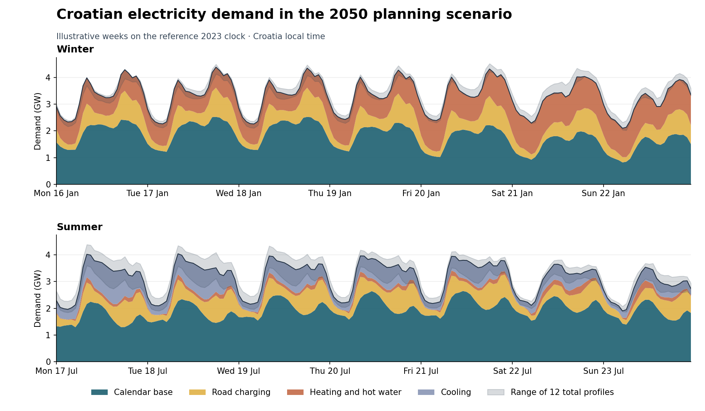

# Croatian electricity demand inputs for H2RES

The fixed-charging case provides 60 Croatian electricity demand series. Each planning year has 12 model alternatives on the same 8,760-hour 2023 UTC chronology. Choose one total column per run.

| Planning year | Hourly inputs | Annual electricity (TWh) | Range of annual peaks (GW) |
|---|---|---:|---:|
| 2030 | [2030.csv.gz](../results/planning/h2res/2030.csv.gz) | 20.539 | 3.392–3.768 |
| 2035 | [2035.csv.gz](../results/planning/h2res/2035.csv.gz) | 22.161 | 3.593–4.092 |
| 2040 | [2040.csv.gz](../results/planning/h2res/2040.csv.gz) | 23.783 | 3.921–4.458 |
| 2045 | [2045.csv.gz](../results/planning/h2res/2045.csv.gz) | 25.050 | 4.197–4.711 |
| 2050 | [2050.csv.gz](../results/planning/h2res/2050.csv.gz) | 26.317 | 4.548–4.963 |

The [manifest](../results/planning/h2res/manifest.json) records the run options, energy targets, scale factors and file hashes. The [2023 reference table](../results/planning/h2res/reference-2023.csv.gz) contains the three historical deductions and the residual for each model. [Model names and column IDs](../README.md#models-and-results) are listed in the repository overview.

## Import and compare in H2RES

1. Select a planning-year file and import `<model>__total_mw` as hourly demand in MW. The corresponding `<model>__baseline_mw` and the three common sector columns are available to inspect the decomposition.
2. Match `reference_timestamp_utc` to the same 2023 UTC hours in wind and solar availability and hydro inflows. Use the file name to select the planning-year assumptions. The timestamps describe the reference weather and calendar.
3. Reconcile the electricity balance at import. The total already includes fixed road charging, heating and hot water, cooling, and the NECP network-loss budget. Count each once in the balance. Use the separately documented [flexible charging case](planning.md#profile-sensitivities) if H2RES schedules passenger charging.
4. Hold the other inputs constant within a planning year, including installed stock and retirements, technology costs and constraints, resource chronology, exchange assumptions and reliability settings. Change the demand model column between runs. Compare investments in generation and storage, annualised system cost and unserved energy. Record the H2RES configuration and compare solver status alongside each result.

The reported peaks are **demand inputs**. Capacity and cost results depend on the H2RES configuration and solver runs. The TimesFM-3 series is provided for academic, non-commercial research under the [data and checkpoint terms](../data/README.md).

## Demand figures



The left panel uses the calendar model to show changes across planning years. The right panel shows the distribution of the 12 annual peaks for each year. Both panels use the published fixed-charging tables.



The shaded band spans the minimum and maximum across the 12 total profiles in each hour. The coloured layers give the calendar model's residual and the three shared additions.

## Profile construction

1. Start with the [12 archived 2023 load forecasts](../results/profiles/), built from ENTSO-E demand history, the Croatian calendar and ERA5 weather. Use the same archived model shape in every planning year. The forecasting models are documented in the [benchmark methodology](methodology.md).
2. Subtract the same estimated 2023 road charging, heating and household hot water, and cooling demand from each forecast, hour by hour. The annual deductions are 0.0185, 3.3934 and 0.7091 TWh, from Eurostat and JRC-IDEES. These use the reference hourly shapes in the [planning methodology](planning.md#hourly-profiles).
3. Set each year's annual total from Croatian NECP electricity delivered to consumers plus network losses. Take the road electricity budget from the same balance. Split road electricity into passenger and commercial budgets using Croatian TYNDP National Trends shares. Take space heating and cooling budgets from Croatian TYNDP data for households and services. Keep household hot water at its 2023 Eurostat value. NECP values for 2035 and 2045 and TYNDP values for 2045 are interpolated. The annual residual budget is the total minus the three end-use budgets.
4. Scale each model's residual and each end-use shape to its own annual budget. For a shape with hourly weights `w[t]` and annual energy `E` in MWh, assign `E * w[t] / sum(w)` to hour `t`. Values in MWh per hour are numerically equal to average MW. Use Croatian seasonal TYNDP passenger profiles, the Borlaug et al. depot proxy for commercial vehicles and Croatian Hotmaps profiles for future heating, household hot water and cooling. Sum the scaled residual and sector additions by hour.

The [annual and road source register](../data/planning/sources.json) identifies the input tables, selections and hashes. The [Hotmaps register](../data/planning/hotmaps-sources.json) identifies the exact profile datasets for households and services. The [scenario configuration](../configs/planning.json) records the extracted annual values. The [planning methodology](planning.md#consolidated-planning-case) discusses assumptions and sensitivity options, including fixed versus flexible charging, the household hot-water budget and the use of useful thermal profiles as proxies for electric load timing.

## Reproduce the inputs and figures

From the repository root with Python 3.12:

```bash
python -m pip install -r requirements-training.txt -r requirements-figures.txt
python src/planning.py --thermal-profile hotmaps-all --passenger-shape tyndp-seasonal --output work/h2res
python src/planning_figure.py --table work/h2res/2050.csv.gz --output work/h2res/2050-weeks.png --annual-output work/h2res/planning-years.png
```

The generator uses the source extracts and archived forecasts included in this repository. The planning tests verify the published file hashes, compare regenerated values and check hourly decomposition and annual energy closure across all 60 series.
