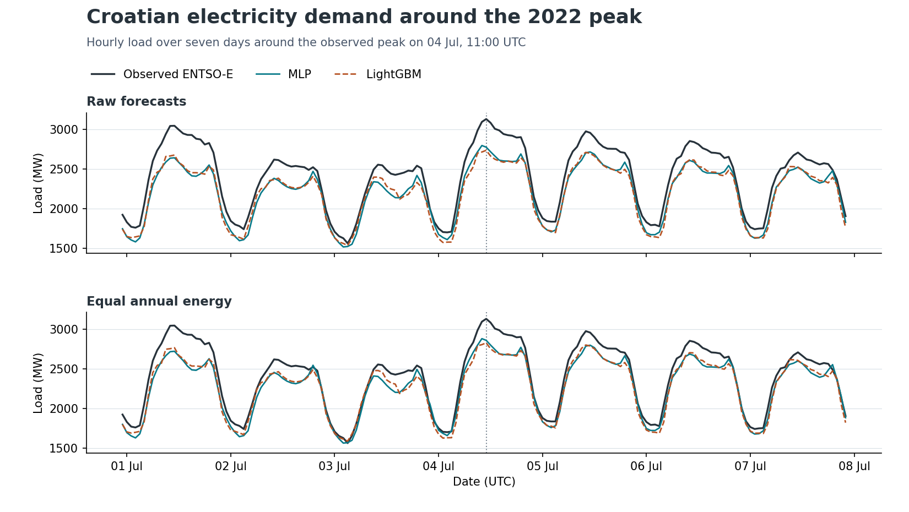

# Development results

These four annual forecasts per workflow were used for model development. See [how the metrics are calculated](methodology.md#scoring), the [annual results](../results/by-year.csv) and the [four-year means](../results/summary.csv). The [2023–2025 comparison](retrospective.md) reports the later years separately.

## Winners by year

| Year | Lowest raw hourly MAE | Lowest equal-energy shape MAE |
|---|---|---|
| 2019 | TCN · 77.92 MW | TimesFM-3 · 67.99 MW |
| 2020 | LightGBM · 81.29 MW | LightGBM · 76.66 MW |
| 2021 | MLP · 83.58 MW | LightGBM · 65.39 MW |
| 2022 | TCN · 78.57 MW | TCN · 72.15 MW |

These scores are descriptive because 2019–2022 was also used to select model settings. Use the [retrospective results](retrospective.md) for the comparison on later years.

## What the scores tell us

| Metric | Four-year leader | Mean |
|---|---|---:|
| Raw hourly MAE | TCN | 86.39 MW |
| Equal-energy shape MAE | LightGBM | 71.12 MW |
| Equal-energy peak magnitude error | MLP | 101.76 MW |
| Equal-energy ramp MAE | Calendar baseline | 21.95 MW |
| Top-5% load-hour overlap | TimesFM-3 | 70.31% |

## Hourly example

The seven-day window is centred on the highest observed load in 2022. The top panel shows the raw forecasts, and the bottom panel shows them after scaling each **entire year** to the observed annual energy. The figure illustrates the transformation on actual hourly curves. The metrics in the tables are calculated over all hours.

[All-model weekly plots](../results/figures/) · [Hourly forecast files](../results/profiles/)

## Scope

The forecasts use observed ERA5 weather. This evaluates how the workflows reproduce load under a known weather path. The final 2026 comparison and the evaluation of demand profiles in H2RES, an energy-system planning model, are future steps.
