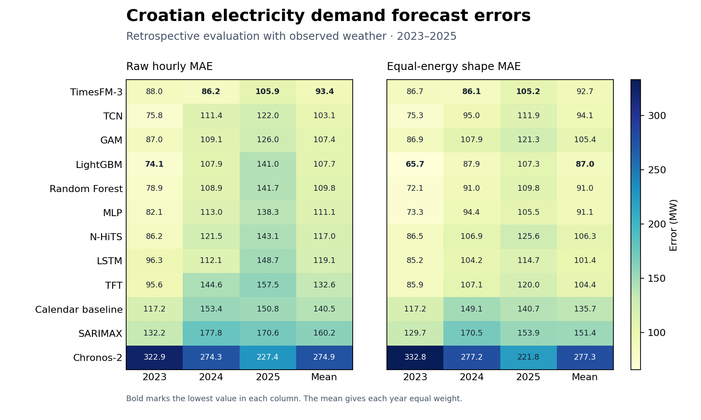

# Retrospective results for 2023–2025

At each January 1 UTC origin, the 12 fixed configurations use demand available through the preceding December and the target year's calendar and observed ERA5 weather. These years provide a retrospective comparison. The final held-out demand evaluation is reserved for 2026. See the [methodology](methodology.md) for the split, data availability and metric definitions.

## Hourly error by year

All MAEs are in MW. Raw MAE scores the original forecast. Shape MAE scores after matching the observed annual energy. Bold marks the lowest error in each column. Models are ordered by their mean raw MAE, with equal weight per year.

| Model | 2023 raw | 2023 shape | 2024 raw | 2024 shape | 2025 raw | 2025 shape |
|---|---:|---:|---:|---:|---:|---:|
| TimesFM-3 | 87.95 | 86.74 | **86.25** | **86.07** | **105.88** | **105.24** |
| TCN | 75.76 | 75.28 | 111.44 | 95.03 | 122.01 | 111.93 |
| GAM | 87.03 | 86.91 | 109.14 | 107.90 | 125.97 | 121.26 |
| LightGBM | **74.12** | **65.72** | 107.89 | 87.87 | 141.04 | 107.27 |
| Random Forest | 78.94 | 72.07 | 108.87 | 91.04 | 141.66 | 109.80 |
| MLP | 82.13 | 73.33 | 112.97 | 94.36 | 138.28 | 105.48 |
| N-HiTS | 86.21 | 86.53 | 121.51 | 106.92 | 143.14 | 125.59 |
| LSTM | 96.32 | 85.18 | 112.13 | 104.22 | 148.74 | 114.71 |
| TFT | 95.55 | 85.93 | 144.62 | 107.13 | 157.49 | 120.03 |
| Calendar baseline | 117.22 | 117.24 | 153.43 | 149.10 | 150.79 | 140.69 |
| SARIMAX | 132.16 | 129.69 | 177.82 | 170.52 | 170.56 | 153.91 |
| Chronos-2 | 322.94 | 332.82 | 274.34 | 277.23 | 227.45 | 221.81 |

The lowest raw MAE was achieved by LightGBM in 2023, TimesFM-3 in 2024 and TimesFM-3 in 2025. LightGBM had the lowest mean shape MAE (86.95 MW) and the highest mean overlap with the observed top 5% of hours (67.32%).

These rankings describe the three evaluation years. TimesFM-3 was released after their forecast origins, and overlap between its pretraining data and Croatian load remains unverified. See [pretrained checkpoints](methodology.md#pretrained-checkpoints).

## Profiles and downloads

Weekly means show the annual curves against observed demand for every workflow. Scores use the original hourly values.

| Target year | Observed vs forecast | Hourly forecasts |
|---|---|---|
| 2023 | [All 12 curves](../results/figures/profiles-2023.png) | [CSV.gz](../results/profiles/2023.csv.gz) |
| 2024 | [All 12 curves](../results/figures/profiles-2024.png) | [CSV.gz](../results/profiles/2024.csv.gz) |
| 2025 | [All 12 curves](../results/figures/profiles-2025.png) | [CSV.gz](../results/profiles/2025.csv.gz) |

[All metrics by year](../results/retrospective/by-year.csv) · [Period means](../results/retrospective/summary.csv) · [Archive provenance](../results/provenance.json) · [Reproduction commands](reproduction.md)
